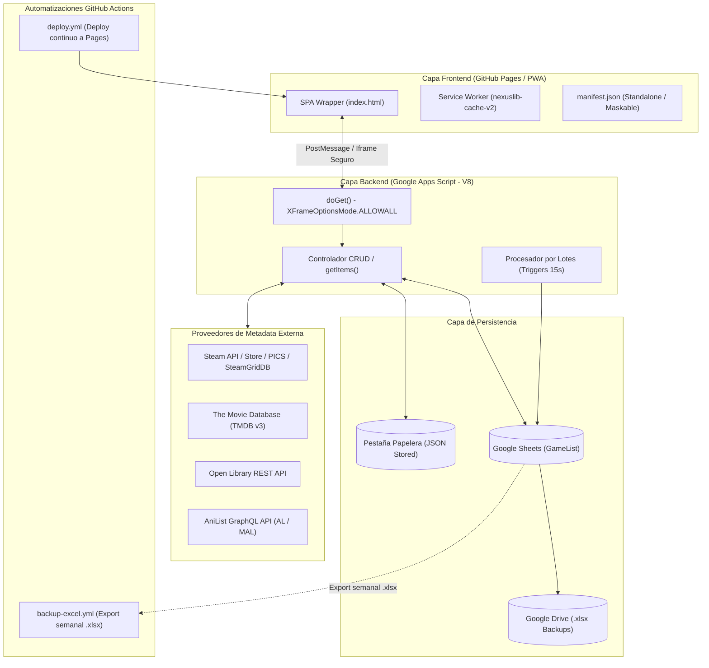

<div align="center">

# 🌌 NexusLib
### *Plataforma Multimedia Colaborativa & Progressive Web App (PWA)*

Gestión, seguimiento y sincronización en tiempo real de **Videojuegos, Cine/Series, Libros y Mangas**.  
Diseñado para sincronizarse en la nube con **Google Sheets**, operado por un backend en **Google Apps Script** y servido estáticamente mediante **GitHub Pages**.

[](https://angellrnzo.github.io/nexuslib/)
[](https://angellrnzo.github.io/nexuslib/)
[](https://developers.google.com/apps-script)
[](https://www.google.com/sheets/about/)

---

[🌐 Ver Aplicación en Vivo](https://angellrnzo.github.io/nexuslib/) • [📖 Consultar la Wiki Técnica](WIKI.md) • [Reportar Bug](https://github.com/angellrnzo/nexuslib/issues)

</div>

---

## 📑 Tabla de Contenidos
- [✨ Características Principales](#-características-principales)
- [🏛️ Arquitectura del Sistema](#️-arquitectura-del-sistema)
- [🛠️ Stack Tecnológico](#️-stack-tecnológico)
- [📂 Estructura del Repositorio](#-estructura-del-repositorio)
- [🚀 Despliegue e Instalación](#-despliegue-e-instalación)
- [🔄 Automatización y Backups](#-automatización-y-backups)
- [📖 Wiki Técnica](#-wiki-técnica)
- [👨‍💻 Autor](#-autor)
- [📄 Licencia](#-licencia)

---

## ✨ Características Principales

### 🎮 Gestión Multimedia Multi-Categoría
* **Videojuegos:** Detección de Steam AppIDs, builds estables, ramas beta, notas de parches, compatibilidad con Steam Deck, tags y capturas de alta resolución.
* **Cine y Series:** Integración con catálogo TMDB, temporadas, capítulos, estado de emisión, plataformas de streaming disponibles (Netflix, Prime, Max, Crunchyroll, etc.) y tráilers integrados.
* **Libros:** Búsqueda por ISBN o Work ID en Open Library, páginas, demografía, editorial y fecha de publicación.
* **Mangas:** Búsqueda en AniList GraphQL (compatible con IDs de MyAnimeList), recuento de tomos, demografía y capítulos totales.

### 👥 Seguimiento Colaborativo en Pareja (Angel & Talmai)
* **Perfiles independientes:** Registro de estado individual (*Pendiente, En proceso, Completado*), notas personales, listas de deseados y valoraciones en escala 1 a 10.
* **❤️ Match de Pareja:** Algoritmo interactivo que cruza las bibliotecas para descubrir al instante obras que ambos tienen pendientes o en su lista de deseados mutua.
* **📊 Estadísticas Comparativas:** Métricas cruzadas, notas medias otorgadas, porcentaje de obras completadas y gráficos de barras dinámicos por perfil.
* **📖 Seguimiento de Lectura:** Barra de progreso porcentual y seguimiento dinámico de capítulos leídos en mangas y libros.

### 📱 Experiencia PWA de Alto Rendimiento
* **60 FPS en Móviles:** Virtualización y paginación infinita con `IntersectionObserver` y `content-visibility: auto` (lotes de 36 tarjetas).
* **Navegación Táctil (Swipe):** Deslizamiento horizontal natural entre pestañas de categorías.
* **Reproductor HLS & YouTube:** Soporte de tráilers en streaming sin salir de la app (inyección dinámica de `hls.js` para `.m3u8`).
* **Caché Inteligente:** Almacenamiento local `v19` con expiración de 12 horas para tiempos de carga ultrarrápidos y ahorro de cuota en Google Sheets.
* **Integración Nativa Móvil:** Historial `popstate` para cierre fluido de modales con el botón físico "Atrás" de Android e iOS.

---

## 🏛️ Arquitectura del Sistema



---

## 🛠️ Stack Tecnológico

| Capa | Tecnologías |
| :--- | :--- |
| **Frontend** | HTML5 Semántico, CSS3 Moderno (Custom Properties, Flexbox, Grid), JavaScript Vainilla (ES6+), Web Workers, Service Worker API |
| **Diseño / UI** | Dark Mode Theme (estilo Steam / Plex), Iconografía SVG Vectorial Inline, Backdrop Filter Blur |
| **Backend** | Google Apps Script (Motor V8), `UrlFetchApp`, `PropertiesService`, `ScriptApp` (Time Triggers) |
| **Base de Datos** | Google Sheets API con mapeo relacional de cabeceras dinámicas (`HEADER_TO_KEY`) |
| **APIs Externas** | Steam Store API, SteamCMD PICS, TMDB API v3, Open Library API, AniList GraphQL API |
| **CI/CD & DevOps** | GitHub Actions (`deploy-pages`, Cron Workflows), GitHub Pages |

---

## 📂 Estructura del Repositorio

```text
NexusLib/
├── .github/
│   └── workflows/
│       ├── deploy.yml            # CI/CD: Despliegue continuo de la PWA a GitHub Pages
│       └── backup-excel.yml      # Cron semanal: Exporta y guarda GameList.xlsx en el repo
├── GitHub/                       # Frontend Web estático servido en GitHub Pages
│   ├── index.html                # Contenedor iframe optimizado con políticas seguras
│   ├── manifest.json             # Manifiesto PWA (iconos adaptativos maskable, theme #0b0e14)
│   ├── service-worker.js         # Service Worker con estrategia de caché v2 y auto-limpieza
│   ├── icon-192.png              # Icono PWA para dispositivos móviles (192x192)
│   └── icon-512.png              # Icono PWA en alta resolución (512x512)
├── AppScript/                    # Código fuente del Backend y Base de Datos
│   ├── WebAPP.gs                 # Servidor API en Google Apps Script
│   ├── Index.html                # Single Page Application (SPA) ejecutada dentro de Apps Script
│   ├── GameList.xlsx             # Plantilla y base de datos relacional de ejemplo
│   └── backup_v1/                # Copia de seguridad local versionada
├── .gitignore                    # Exclusiones de archivos del sistema y bloqueos de Excel
├── README.md                     # Documentación principal del proyecto
└── WIKI.md                       # Especificación técnica exhaustiva y manual de desarrollo
```

---

## 🚀 Despliegue e Instalación

### 1. Despliegue del Backend (Google Apps Script)
1. Crea una nueva hoja de cálculo en [Google Sheets](https://sheets.new) o importa `AppScript/GameList.xlsx`.
2. Ve a **Extensiones** $\rightarrow$ **Apps Script**.
3. Copia el contenido de `AppScript/WebAPP.gs` en el archivo de código (`Código.gs`) y crea un archivo HTML llamado `Index` con el contenido de `AppScript/Index.html`.
4. En **Configuración del proyecto** $\rightarrow$ **Propiedades del script**, añade tu clave de TMDB:
   * `TMDB_API_KEY`: Tu clave de The Movie Database.
   * `STEAMGRIDDB_API_KEY` *(Opcional)*: Para portadas alternativas de Steam.
5. Pulsa en **Implementar** $\rightarrow$ **Nueva implementación**:
   * Tipo: *Aplicación web*.
   * Ejecutar como: *Yo*.
   * Quién tiene acceso: *Cualquier usuario*.
6. Copia la URL terminada en `/exec` y pégala en el atributo `src` del iframe en `GitHub/index.html`.

### 2. Despliegue del Frontend (GitHub Pages)
1. Sube este repositorio a tu cuenta de GitHub.
2. Ve a **Settings** $\rightarrow$ **Pages**.
3. En **Build and deployment** $\rightarrow$ **Source**, selecciona **`GitHub Actions`**.
4. ¡Listo! La PWA se publicará automáticamente en tu subdominio de GitHub Pages.

---

## 🔄 Automatización y Backups

El proyecto incorpora un sistema doble de copias de seguridad automáticas:

1. **Backup Semanal en GitHub Actions:**  
   El workflow [.github/workflows/backup-excel.yml](.github/workflows/backup-excel.yml) se ejecuta **cada domingo a las 3:00 AM UTC**. Descarga la hoja de cálculo viva en formato `.xlsx` y actualiza automáticamente `AppScript/GameList.xlsx` con un commit sin intervención humana.
2. **Backup Semanal en Google Drive:**  
   Desde el menú superior **NexusLib** en Google Sheets, puedes activar `Activar backup semanal automático (.xlsx)` para guardar copias fechadas históricas dentro de una carpeta `NexusLib_Backups` en tu propia unidad de Google Drive.

---

## 📖 Wiki Técnica

Para consultar la arquitectura profunda, el flujo de datos, los algoritmos de recuperación ante caídas de APIs y el modelo de datos detallado:

👉 **[Leer la Wiki Completa de NexusLib (WIKI.md)](WIKI.md)**

---

## 👨‍💻 Autor

Desarrollado con dedicación por **Angel Lorenzo**.

<p align="left">
  <a href="https://www.linkedin.com/in/angellrnzo/" target="_blank">
    
  </a>
  <a href="https://github.com/angellrnzo" target="_blank">
    
  </a>
</p>

---

## 📄 Licencia

Este proyecto está bajo la Licencia **MIT**. Consulta el archivo `LICENSE` para más información.
