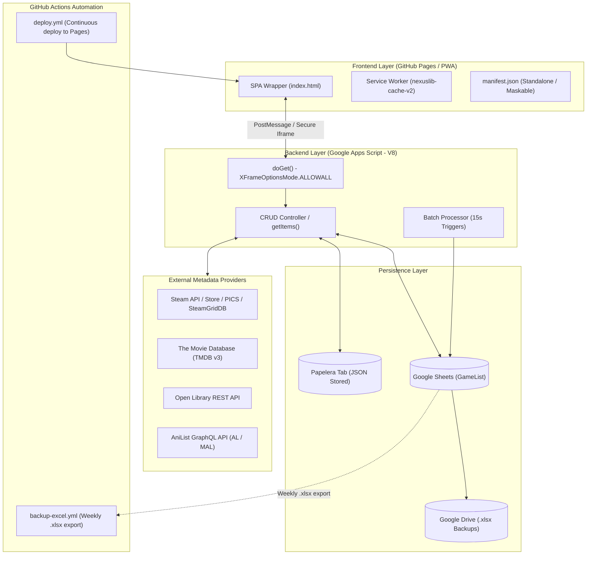

<div align="center">

# 🌌 NexusLib
### *Collaborative Multimedia Platform & Progressive Web App (PWA)*

Real-time tracking and synchronization of **Video Games, Movies/Series, Books, and Manga**.  
Cloud-synced via **Google Sheets**, powered by a **Google Apps Script** backend, and statically hosted on **GitHub Pages**.

[](https://angellrnzo.github.io/nexuslib/)
[](https://angellrnzo.github.io/nexuslib/)
[](https://developers.google.com/apps-script)
[](https://www.google.com/sheets/about/)

---

[🌐 Live App](https://angellrnzo.github.io/nexuslib/) • [📖 Technical Wiki](WIKI.md) • [📋 Roadmap & Audit](AppScript/road.md) • [Report a Bug](https://github.com/angellrnzo/nexuslib/issues)

</div>

---

## 📑 Table of Contents
- [✨ Key Features](#-key-features)
- [🏛️ System Architecture](#️-system-architecture)
- [🛠️ Tech Stack](#️-tech-stack)
- [📂 Repository Structure](#-repository-structure)
- [🚀 Deployment & Setup](#-deployment--setup)
- [🔄 Automation & Backups](#-automation--backups)
- [📖 Technical Wiki](#-technical-wiki)
- [👨‍💻 Author](#-author)
- [📄 License](#-license)

---

## ✨ Key Features

### 🎮 Multi-Category Media Management
* **Video Games:** Steam AppID detection, stable builds, beta branches, patch notes, Steam Deck compatibility, tags, and high-resolution screenshots.
* **Movies & Series:** TMDB catalog integration, seasons/episodes, airing status, streaming platform availability (Netflix, Prime, Max, Crunchyroll, etc.), and embedded trailers.
* **Books:** Search by ISBN or Work ID on Open Library, pages, audience demographics, publisher, and publication date.
* **Manga:** AniList GraphQL search (compatible with MyAnimeList IDs), volume count, demographics, and total chapters.

### 👥 Couple Collaborative Tracking (Angel & Talmai)
* **Independent profiles:** Per-user status (*Pending, In Progress, Completed*), personal notes, wishlists, and 1-to-10 star ratings.
* **❤️ Couple Match:** Interactive algorithm that cross-references both libraries to instantly surface titles both users have pending or mutually wishlisted.
* **📊 Comparative Statistics:** Cross metrics, average ratings, completion percentages, and dynamic bar charts per profile.
* **📖 Reading Progress:** Percentage progress bar and dynamic chapter tracking for manga and books.
* **🎮 Game Mods Tracker** *(planned)* — per-user mod lists inside each game's detail (Nexus Mods / Steam Workshop / CurseForge / custom URL), grouped by game version. Spec in `AppScript/road.md`.

### 📱 High-Performance PWA Experience
* **60 FPS on Mobile:** Virtualization and infinite pagination with `IntersectionObserver` and `content-visibility: auto` (batches of 36 cards).
* **Touch Navigation (Swipe):** Natural horizontal swiping between category tabs.
* **HLS & YouTube Player:** In-app trailer streaming without leaving the app (dynamic `hls.js` injection for `.m3u8`).
* **Smart Cache:** `v19` local storage with 12-hour expiration for lightning-fast loads and reduced Google Sheets quota usage.
* **Native Mobile Integration:** `popstate` history handling for smooth modal dismissal via the Android/iOS hardware "Back" button.

---

## 🏛️ System Architecture



---

## 🛠️ Tech Stack

| Layer | Technologies |
| :--- | :--- |
| **Frontend** | Semantic HTML5, Modern CSS3 (Custom Properties, Flexbox, Grid), Vanilla JavaScript (ES6+), Service Worker API |
| **Design / UI** | Dark Mode Theme (Steam / Plex style), Inline Vector SVG Iconography, Backdrop Filter Blur |
| **Backend** | Google Apps Script (V8 Engine), `UrlFetchApp`, `PropertiesService`, `ScriptApp` (Time Triggers) |
| **Database** | Google Sheets API with dynamic header mapping (`HEADER_TO_KEY`) |
| **External APIs** | Steam Store API, SteamCMD PICS, TMDB API v3, Open Library API, AniList GraphQL API |
| **CI/CD & DevOps** | GitHub Actions (`deploy-pages`, Cron Workflows), GitHub Pages |

---

## 📂 Repository Structure

```text
NexusLib/
├── .github/
│   └── workflows/
│       ├── deploy.yml            # CI/CD: Continuous PWA deployment to GitHub Pages
│       └── backup-excel.yml      # Weekly cron: Exports and commits GameList.xlsx to the repo
├── AppScript/                    # Backend source code and database
│   ├── WebAPP.gs                 # Google Apps Script API server
│   ├── Index.html                # Single Page Application (SPA) run inside Apps Script
│   ├── road.md                   # Project overview, audit & execution roadmap
│   └── GameList.xlsx             # Example relational database template
├── .gitignore                    # System file and Excel lock exclusions
├── .nojekyll                     # Disables the Jekyll processor on GitHub Pages
├── icon-192.png                  # PWA icon for mobile devices (192x192)
├── icon-512.png                  # High-resolution PWA icon (512x512)
├── icon-maskable-512.png         # Adaptive maskable PWA icon (512x512)
├── index.html                    # PWA container with secure iframe policies
├── manifest.json                 # PWA manifest (adaptive maskable icons, theme #0b0e14)
├── service-worker.js             # Service Worker with v2 cache strategy and auto-cleanup
├── README.md                     # Main project documentation
└── WIKI.md                       # Exhaustive technical specification & dev handbook
```

---

## 🚀 Deployment & Setup

### 1. Deploying the Backend (Google Apps Script)
1. Create a new spreadsheet in [Google Sheets](https://sheets.new) or import `AppScript/GameList.xlsx`.
2. Go to **Extensions** → **Apps Script**.
3. Copy the contents of `AppScript/WebAPP.gs` into the code file (`Code.gs`) and create an HTML file named `Index` with the contents of `AppScript/Index.html`.
4. In **Project Settings** → **Script Properties**, add your API keys:
   * `TMDB_API_KEY`: Your The Movie Database key.
   * `STEAMGRIDDB_API_KEY` *(Optional)*: For alternative Steam covers.
5. Click **Deploy** → **New deployment**:
   * Type: *Web app*.
   * Execute as: *Me*.
   * Who has access: *Anyone*.
6. Copy the URL ending in `/exec` and paste it into the iframe `src` attribute in `index.html`.

### 2. Deploying the Frontend (GitHub Pages)
1. Push this repository to your GitHub account.
2. Go to **Settings** → **Pages**.
3. Under **Build and deployment** → **Source**, select **`GitHub Actions`**.
4. Done! The PWA will be published automatically on your GitHub Pages subdomain.

---

## 🔄 Automation & Backups

The project includes a dual automatic backup system:

1. **Weekly GitHub Actions Backup:**  
   The workflow [.github/workflows/backup-excel.yml](.github/workflows/backup-excel.yml) runs **every Sunday at 3:00 AM UTC**. It downloads the live spreadsheet as `.xlsx` and automatically updates `AppScript/GameList.xlsx` with a commit — no human intervention required.
2. **Weekly Google Drive Backup:**  
   From the **NexusLib** menu in Google Sheets, you can enable `Activar backup semanal automático (.xlsx)` to save dated historical copies inside a `NexusLib_Backups` folder in your own Google Drive.

---

## 📖 Technical Wiki

For deep architecture, data flow, API-failure recovery algorithms, and the detailed data model:

👉 **[Read the Full NexusLib Wiki (WIKI.md)](WIKI.md)**

---

## 👨‍💻 Author

Developed with dedication by **Angel Lorenzo**.

<p align="left">
  <a href="https://www.linkedin.com/in/angellrnzo/" target="_blank">
    
  </a>
  <a href="https://github.com/angellrnzo" target="_blank">
    
  </a>
</p>

---

## 📄 License

This project is licensed under the **MIT License**. See the `LICENSE` file for more information.
